# FTune: free, open-source Spotify alternative for Windows & macOS

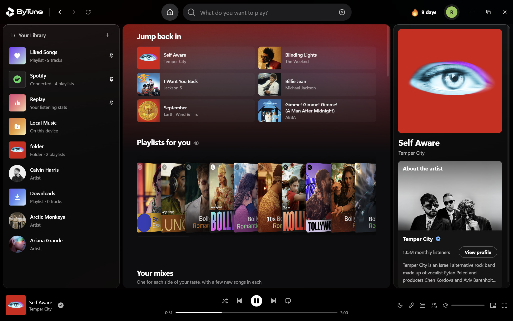

**FTune is a free, open-source music player for Windows and macOS: the YouTube Music catalog and your own files in one app, with no ads, no subscription and word-synced lyrics.** Bring your Spotify playlists over, listen together with friends in Rooms, and get a real desktop player: a mini player, a fullscreen view, media keys and Replay listening stats.

**[Download](#installation)** · **[Website](https://ftune.space/)** · **[Changelog](https://ftune.space/changelog)** · **[Releases](https://github.com/Skaff10/FTune/releases)** · **[Contributing](CONTRIBUTING.md)** · **[License](#license)**

[](https://github.com/Skaff10/FTune/releases/latest)
[](https://github.com/Skaff10/FTune/releases)
[](https://github.com/Skaff10/FTune/stargazers)
[](LICENSE)
[](#installation)

---

## What is FTune?

FTune is a desktop music player for Windows and macOS, built with Electron, React and TypeScript. It streams YouTube Music's public catalog without a Google sign-in, plays your own files (MP3, M4A/AAC, FLAC, WAV, OGG and Opus) in the same library, and wraps both in a proper desktop player: one queue, word-synced lyrics, playlists, a mini player, listening stats and keyboard shortcuts.

The website compares FTune with the other ways to get [YouTube Music on the desktop](https://ftune.space/youtube-music-desktop-app) and with the [free, open-source Spotify alternatives](https://ftune.space/spotify-alternative).

It started as a desktop port of the GPL-licensed BitChord Android player, then grew into a full desktop app of its own — now shipping natively on Windows and macOS from one codebase.

**Highlights**

- **YouTube Music on the desktop** — a home feed that learns from the songs you finish and skip, Explore with moods, genres and podcasts, and search across songs / videos / albums / artists / playlists, all without an account
- **Word-synced lyrics** — the current line (and word) highlighted in time with the music, auto-scrolling, click any line to jump; 13 lyric sources, including [LRCLIB](https://lrclib.net) and Musixmatch, with timing you can nudge per song ([how it works](https://ftune.space/lyrics))
- **Rooms** — listen together with up to 10 people, you included, everyone hearing the same song at the same moment on their own computer ([how Rooms work](https://ftune.space/listen-together))
- **Spotify playlists** — paste a public playlist link or a list of songs, and FTune finds each one on YouTube Music; no Spotify sign-in needed
- **Endless AutoPlay** — when the queue runs out, songs that fit keep the music going
- **Fullscreen Now Playing** — big artwork, queue and lyrics in one view, with optional moving covers
- **Mini player (picture-in-picture)** — a compact always-on-top window that stays out of the way, and folds into a slim bar
- **Local music library** — import folders, get albums/artists/sorting, with non-music audio (voice notes, clips) filtered out
- **Downloads** — save songs to play offline, with live progress and your choice of folder and quality
- **Replay** — your listening counted by week, month, year or all time: top artists and songs, minutes, your streak and the hour you listen most
- **Sound** — a 10-band equalizer, volume leveling, crossfade up to 12 seconds with beat-aware Automix, skip silence, pitch-preserving playback speed, a sleep timer and an output device picker
- **Updates in the app** — FTune tells you when a new version is out; on Windows it installs from inside the app
- **Windows integration** — media keys and the SMTC media overlay, close to the tray (the music pauses), custom title bar with snap-layout-aware caption buttons, right-click context menus
- **macOS integration** — native traffic lights, a real app menu with playback controls, close-to-hide playback, Keychain-backed secrets

## A free Spotify alternative

FTune is for people who want a full desktop music player without ads or a subscription. Everything in it is free: streaming from the YouTube Music catalog, your own files, word-synced lyrics, playlists, Replay and Rooms. There is no paid tier.

- **Bring your playlists.** Paste a public Spotify playlist link, or a list of songs one per line as `Artist - Title`, and FTune finds each song on YouTube Music. CSV exports from Exportify or TuneMyMusic work too, and any song it can't find is listed as *Not on YouTube Music*.
- **Not a Spotify player.** FTune doesn't play Spotify's catalog, and importing a public link needs no Spotify sign-in. The import reads Spotify's public pages rather than an official API, so a change on Spotify's side can break it.

How FTune compares with Spotify, YouTube Music and the other open-source players, with prices and sources: [ftune.space/spotify-alternative](https://ftune.space/spotify-alternative).

## Listen together in Rooms

A Room lets up to 10 people, host included, hear the same song at the same moment, each on their own Windows PC or Mac. One person starts a Room and shares its six-character code or an invite link; the others join from FTune. Anyone can play, pause, skip or change the shared queue of up to 100 songs, unless the host turns on **Only the host controls the music**. Each computer checks its place every few seconds and corrects itself when it drifts more than about a second.

Everyone needs FTune 1.1.0 or later and a free FTune account. Songs from your own music folders can't play in a Room, and there's no chat, so talk over a call while you listen. More on how Rooms work: [ftune.space/listen-together](https://ftune.space/listen-together).

## Screenshots

Captured on the Windows edition — the macOS edition shares this same interface behind native Mac chrome (traffic lights, app menu bar).

### The player

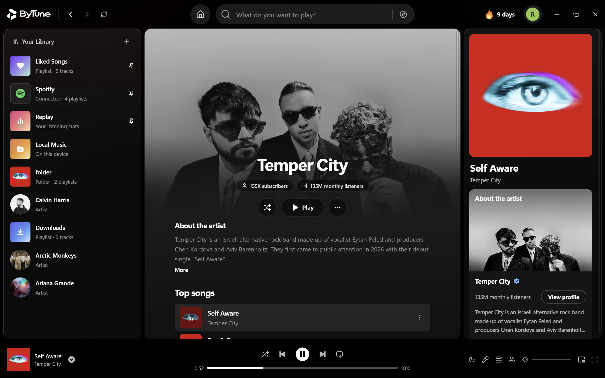

Album pages, artist pages and the persistent player bar: every view keeps playback, the queue and lyrics one click away.

### Fullscreen

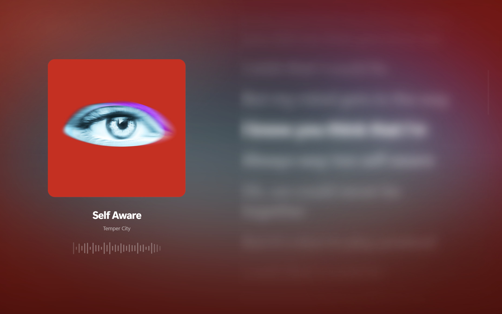

Click the artwork in the player bar (or press <kbd>N</kbd>) for a cinematic view: large artwork, a live visualizer, the queue and word-synced lyrics — all tinted by the colors of the current track.

### Mini player


The mini player is a real picture-in-picture window: always on top, resizable, with playback controls on hover. A button at the top folds it into a slim bar with the cover, the song, like, previous, play and next. Work in something else and keep the music one glance away.

### Lyrics

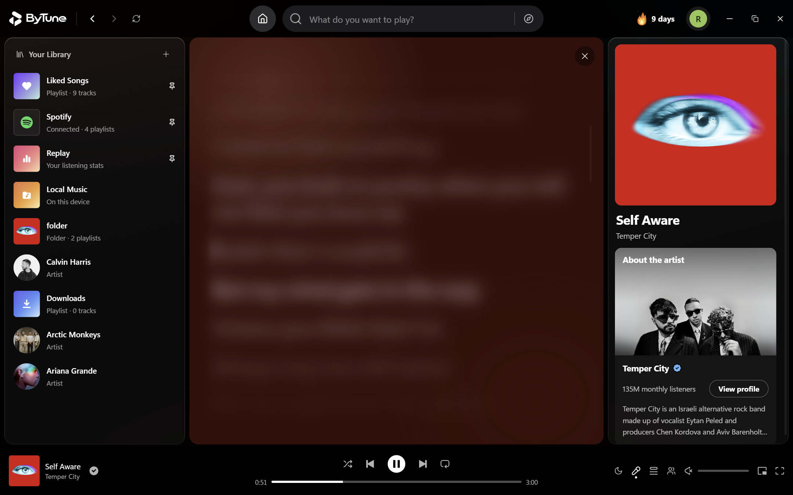

Lyrics open in the main view or the fullscreen player, highlight the current word, auto-scroll, and let you click any line to seek there. FTune asks 13 lyric sources, including LRCLIB and Musixmatch, and takes the highest-ranked one that has timing: word by word when that source has it, line by line otherwise. You can nudge the timing per song, and the app always shows which source it used.

### Search

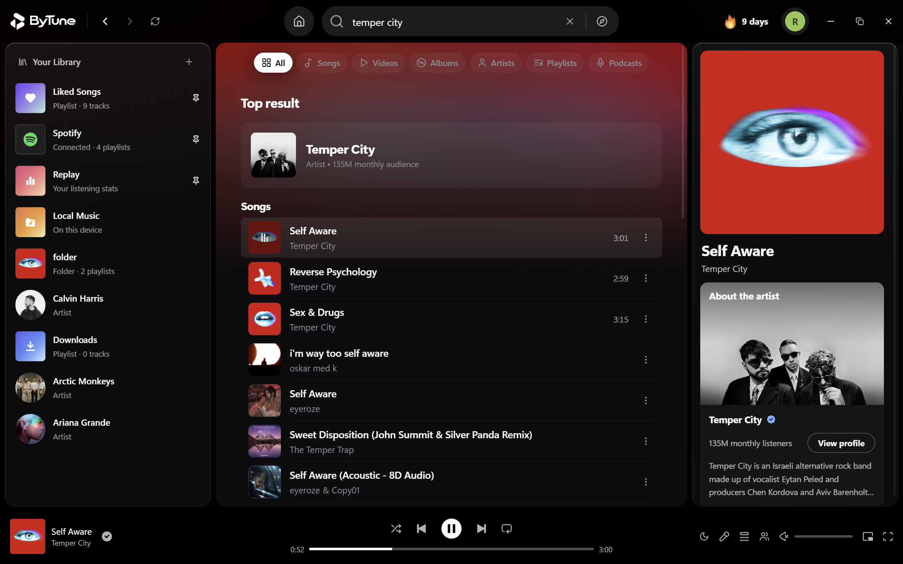

Search songs, videos, albums, artists and playlists from YouTube Music, with live suggestions as you type. Press <kbd>/</kbd> to jump to the search bar from anywhere.

### Queue & playlists

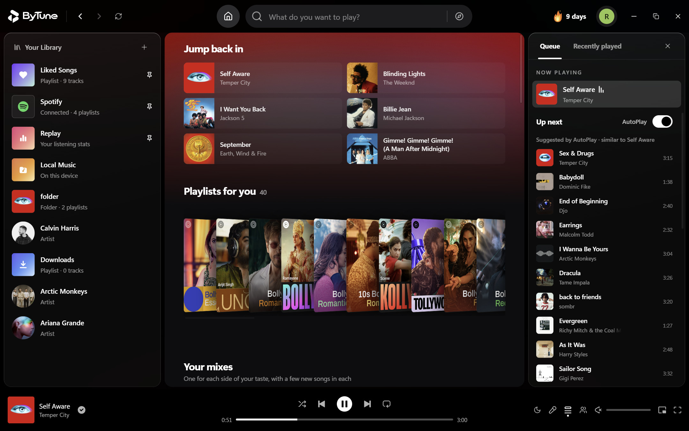

A proper queue: see what's playing and what's next, reorder by drag, add with "Play next" or "Add to queue" from any track's right-click menu, and keep the music going with endless AutoPlay when the queue ends. Shuffle, repeat (off / all / one) and crossfade are one click away.

### Your library

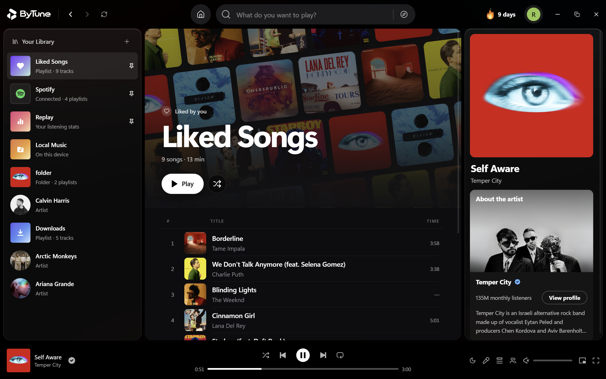

Your library persists on disk and restores on launch: liked songs, your own playlists, downloads and listening history — with an optional free account that keeps it in sync between your computers and safe even if this computer's app data is wiped.

### Local music

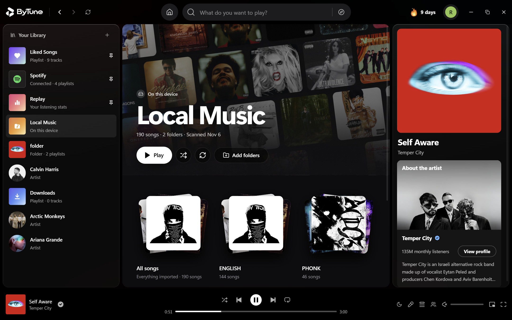

Import folders from your PC and they sit beside your streaming library — full track lists, album and artist browsing, embedded artwork, and a filter that hides short recordings and voice notes.

### Downloads

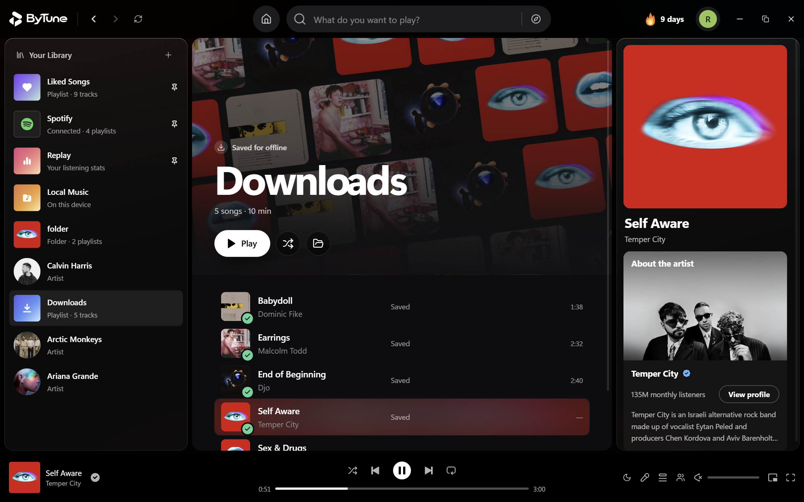

Save songs for offline listening, with live progress, an "Open folder" shortcut, a configurable download location and a choice of quality. Downloaded songs play from the file, with their title, artist and cover.

### Replay

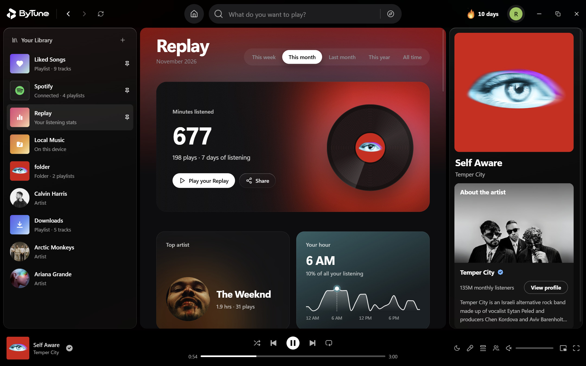

<p align="center">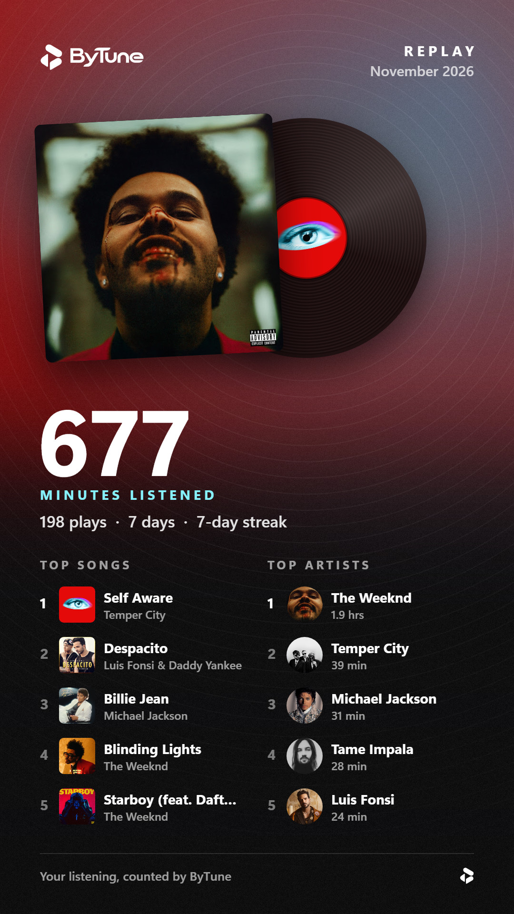</p>

Replay counts your listening, and follows your account if you sign in: minutes, plays, your top songs, artists and albums, your streak and the hour you listen most, by week, month, year or all time. **Share** turns it into a 1080 × 1920 card sized for a story.

### Settings

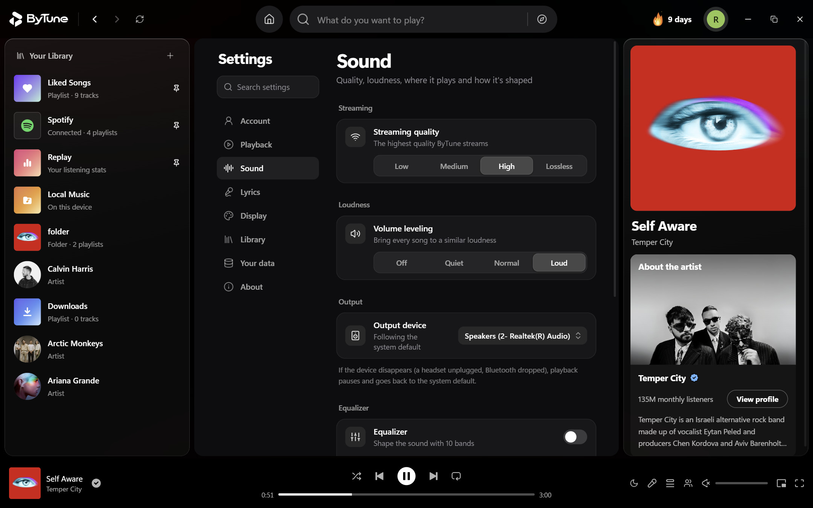

Streaming and download quality, a 10-band equalizer, volume leveling and the output device, crossfade and Automix, skip silence, AutoPlay, pitch-preserving playback speed, lyric behavior, appearance (liquid glass, reduced motion) and local-music management — all in one settings page.

## Feature overview

| Feature | FTune |
|---|---|
| Free: no ads, no subscription, no paid tier | ✅ |
| Open source (GPL-3.0) | ✅ |
| Streaming from YouTube Music (no Google sign-in) | ✅ |
| Search (songs / videos / albums / artists / playlists) | ✅ |
| Word- or line-synced lyrics from 13 sources, with click-to-seek | ✅ |
| Rooms: listen together with up to 10 people, you included | ✅ (free account) |
| Spotify playlist import (public link or a list of songs) | ✅ |
| Fullscreen Now Playing view | ✅ |
| Mini player (picture-in-picture) with a compact bar | ✅ |
| Queue with reorder, play next and endless AutoPlay | ✅ |
| Playlists, liked songs, listening history | ✅ |
| Playlist export and import (.m3u8, JSON) | ✅ |
| Local music library (MP3, M4A/AAC, FLAC, WAV, OGG, Opus) | ✅ |
| Downloads for offline listening | ✅ |
| Listening statistics (Replay) | ✅ |
| 10-band equalizer, volume leveling, output device picker | ✅ |
| Crossfade, Automix, skip silence, playback speed, sleep timer | ✅ |
| Update notices in the app | ✅ |
| Optional free account: library sync between computers | ✅ |
| Windows media keys + SMTC overlay, close to tray (music pauses) | ✅ Windows |
| Native traffic lights & hidden-inset title bar | ✅ macOS |
| macOS menu bar with playback controls | ✅ macOS |
| Close-to-hide: music keeps playing, Dock restores | ✅ macOS |
| Keychain-backed secret storage | ✅ macOS |
| Apple Silicon + Intel builds | ✅ macOS |
| Keyboard shortcuts | ✅ |
| Artwork-driven ambient theming (dark) | ✅ |
| Lossless streaming | ❌ (streams play at the best quality YouTube Music offers FTune; your own FLAC and WAV files play lossless) |
| Last.fm scrobbling | ❌ |
| Android or iOS app | ❌ (desktop only) |
| Light theme | ❌ (dark only, by design) |

## Why FTune?

- **No ads, no subscription.** Everything is free, including the optional account — no paid tier, no locked features, no dark patterns.
- **Desktop-first.** A real window, media keys, keyboard shortcuts, a taskbar- and Dock-friendly mini player — not a website in a wrapper.
- **Two libraries, one player.** Streaming from YouTube Music and your own files, side by side, with the same queue, lyrics and downloads.
- **Listen together.** Rooms keep friends on the same song at the same moment, each on their own computer.
- **No login required.** Guest mode keeps your data on this computer; accounts are optional, and only Rooms need one.
- **Open source.** GPL-3.0; every line is inspectable and contributions are welcome. The app has no telemetry or analytics: your listening stats stay on your computer, or in your own account if you sign in.

FTune is not affiliated with or endorsed by YouTube, Google or Spotify, and it is unrelated to FTune Electronics Co., Ltd.

If FTune has earned a spot on your taskbar, consider starring the repo (the ★ button, top right) — it's how other people find the project.

## The macOS experience

On a Mac, FTune behaves like a Mac app:

- **Native traffic lights.** The window uses the real macOS close/minimize/fullscreen buttons in their standard place; the UI leaves room for them instead of drawing fake ones.
- **A real menu bar.** FTune · File · Edit · View · Playback · Window — with live playback checkmarks (Play↔Pause, Shuffle, Repeat), Settings… **⌘,**, backup import/export **⌘O**/**⌘S**, and Find **⌘F**.
- **Closing the window keeps the music playing.** Like Apple Music or Spotify: the red button (or **⌘W**) hides the window and playback continues; click the Dock icon to bring it back. **⌘Q** is the real quit.
- **Media keys and Now Playing.** Play/pause, next and previous respond to the keyboard's media keys, and the current track is published to the system Now Playing info.
- **Keychain-backed secrets.** Sign-in tokens are sealed with the macOS Keychain via Electron's safeStorage, not written as plain text.
- **Retina and Apple Silicon.** The UI is HiDPI-sharp, and native arm64 and Intel builds ship together.

## Keyboard shortcuts

| Action | Windows | macOS |
|---|---|---|
| Play / pause | <kbd>Space</kbd> · media keys | <kbd>Space</kbd> · media keys |
| Seek ±5 s | <kbd>←</kbd> / <kbd>→</kbd> | <kbd>←</kbd> / <kbd>→</kbd> |
| Previous / next track | <kbd>Shift</kbd>+<kbd>←</kbd> / <kbd>Shift</kbd>+<kbd>→</kbd> | <kbd>Shift</kbd>+<kbd>←</kbd> / <kbd>Shift</kbd>+<kbd>→</kbd> |
| Volume · mute | <kbd>↑</kbd> / <kbd>↓</kbd> · <kbd>M</kbd> | <kbd>↑</kbd> / <kbd>↓</kbd> · <kbd>M</kbd> |
| Shuffle · Repeat | <kbd>S</kbd> · <kbd>R</kbd> | <kbd>S</kbd> · <kbd>R</kbd> |
| Queue · Lyrics · Now Playing | <kbd>Q</kbd> · <kbd>L</kbd> · <kbd>N</kbd> | <kbd>Q</kbd> · <kbd>L</kbd> · <kbd>N</kbd> |
| Focus search | <kbd>Ctrl</kbd>+<kbd>F</kbd> or <kbd>/</kbd> | <kbd>⌘</kbd>+<kbd>F</kbd> or <kbd>/</kbd> |
| Fullscreen Now Playing | <kbd>N</kbd> | <kbd>Ctrl</kbd>+<kbd>⌘</kbd>+<kbd>F</kbd> |
| Settings… | — | <kbd>⌘</kbd>+<kbd>,</kbd> |
| Import / export backup | — | <kbd>⌘</kbd>+<kbd>O</kbd> / <kbd>⌘</kbd>+<kbd>S</kbd> |
| Close window (keeps playing) | — | <kbd>⌘</kbd>+<kbd>W</kbd> |
| Quit | — | <kbd>⌘</kbd>+<kbd>Q</kbd> |

Shortcuts never hijack typing — they only fire when a text field isn't focused. On macOS, menu accelerators are deliberately transport-free so they can't steal keystrokes from the app.

## FAQ

**Is FTune free?**

Yes. It's open source under GPL-3.0, with no ads, no subscription and nothing behind a paywall. Accounts are free too, and only Rooms need one.

**Is FTune a good Spotify alternative?**

If you want a free desktop music player without ads, that's what it's built for: the YouTube Music catalog and your own files in one library, word-synced lyrics, playlists and Rooms for listening together, on Windows and macOS. It doesn't play Spotify's own catalog; your Spotify playlists come over from a link or a list of songs, and FTune finds each song on YouTube Music. A comparison with Spotify, YouTube Music and other open-source players: [ftune.space/spotify-alternative](https://ftune.space/spotify-alternative).

**Is FTune safe?**

Its code is public, so anyone can check what it does, and the app has no telemetry or analytics: your listening stats stay on your computer, or in your own account if you sign in. Every release file has a SHA-256 checksum on GitHub, and the current ones are listed [below](#verify-your-download), so you can confirm your download is the one this project built. The installers aren't code-signed yet, which is why Windows SmartScreen or macOS asks once before the first launch. Get FTune only from [ftune.space](https://ftune.space/download) or this repository's [Releases page](https://github.com/Skaff10/FTune/releases).

**Does it need a YouTube Music Premium or Google account?**

No. FTune streams YouTube Music's public catalog without a Google sign-in. A free FTune account is optional: it keeps your library, settings and Replay history in sync between computers, and it's needed for Rooms.

**Is this the official YouTube Music app?**

No. FTune is an independent, open-source desktop player that uses YouTube Music as a streaming source. It is not affiliated with or endorsed by YouTube or Google.

**Which platforms does it run on?**

Windows 10 and 11 (64-bit), and macOS 13 Ventura or later on Apple Silicon and Intel. There is no Android or iPhone app. The Windows edition is the more mature of the two; macOS builds are newer.

**Can I listen to music together with friends?**

Yes, in a Room: up to 10 people, you included, hear the same song at the same moment, each on their own computer. Share the six-character code or an invite link, and play from a shared queue of up to 100 songs. Everyone needs a free FTune account, and songs from your own files stay out of Rooms. [How Rooms work](https://ftune.space/listen-together).

**Can I import my Spotify playlists?**

Yes. Paste a public Spotify playlist link, or a list of songs one per line as `Artist - Title`, and FTune finds each song on YouTube Music. No Spotify sign-in is needed, and any song it can't find is listed as *Not on YouTube Music*.

**Can I play my own music files?**

Yes. Import up to 200 folders and FTune plays MP3, M4A/AAC, FLAC, WAV, OGG and Opus files with their tags and cover art, in the same library as streaming. A non-music filter, on by default, keeps voice notes and recordings out.

**Can I save songs for offline listening?**

Yes. Downloaded songs play offline from the file, with your choice of folder and quality.

**Where do I download FTune?**

From [ftune.space/download](https://ftune.space/download) or this repository's [Releases page](https://github.com/Skaff10/FTune/releases). Those are the only official sources; the steps are under [Installation](#installation).

## Built with

**Application** — Electron · React 18 · TypeScript · Tailwind CSS · Zustand

**Streaming & audio** — youtubei.js (YouTube Music / InnerTube) · bgutils-js (BotGuard PO tokens) · music-metadata (local files)

**Backend (optional account)** — Supabase (auth, library sync and Rooms)

**Build & tooling** — Vite · esbuild · electron-builder (NSIS installer on Windows · DMG/ZIP for Apple Silicon and Intel on macOS) · Node's built-in test runner

## Installation

### Download the app

**Windows 10/11 (64-bit)** — grab the installer from the latest release:

**[Download FTune-Setup.exe](https://github.com/Skaff10/FTune/releases/latest/download/FTune-Setup.exe)** ← always points at the newest build

Also available on the [download page](https://ftune.space/download) and the [releases page](https://github.com/Skaff10/FTune/releases). The installer is about 113 MB and by default installs for your user account, without admin rights. If SmartScreen warns on the first run, choose **More info**, then **Run anyway**.

**macOS 13 Ventura or later (Apple Silicon & Intel)** — download the DMG for your Mac from the [releases page](https://github.com/Skaff10/FTune/releases) or the [download page](https://ftune.space/download): `-arm64` for Apple Silicon (M1 and newer), `-x64` for Intel. Not sure which you have? Apple menu → **About This Mac**: "Chip: Apple M…" is Apple Silicon, "Processor: …Intel…" is Intel. Open the DMG and drag **FTune** into **Applications**.

The app isn't notarized by Apple yet, so macOS blocks the first launch once:

- **macOS 15 Sequoia and later:** open FTune, click **Done** on the warning, then go to **System Settings → Privacy & Security**, scroll down to "FTune was blocked…" and click **Open Anyway**.
- **macOS 13–14:** right-click (Control-click) FTune in Applications, choose **Open**, then **Open** again.

If macOS instead says **"FTune is damaged and can't be opened"** (builds up to v1.0.1), the download is fine — those builds weren't signed. Run this once in Terminal, then open FTune normally:

```bash
xattr -cr /Applications/FTune.app
```

To build it yourself, `npm run dist:mac` produces `FTune-<version>-arm64.dmg` / `FTune-<version>-x64.dmg` in `release/`. Signing and notarization steps live in [MAC_BUILD_AND_SIGNING.md](MAC_BUILD_AND_SIGNING.md), the distribution checklist in [DISTRIBUTION.md](DISTRIBUTION.md), and current caveats in [MAC_KNOWN_LIMITATIONS.md](MAC_KNOWN_LIMITATIONS.md).

Run the installer, launch FTune, and pick **Continue as guest** (data stays on this computer) or create an account for cloud backup.

### Verify your download

Every release asset has a published SHA-256 checksum. Check yours against the list below (current as of **v1.1.1**):

| Asset | SHA-256 |
|---|---|
| `FTune-Setup.exe` | `bc8ae737b62826f54429b486bcbbe9d6eedf83c2f4d88d25ae7248945af29bfe` |
| `FTune-1.1.1-arm64.dmg` | `c193f447da06505cc6110b298c8c67499d535a68e74f6ebd3ae9d445eb2589ce` |
| `FTune-1.1.1-arm64.zip` | `cf3944b2a61a43ad2f30bd4f7ea7bdcdfa3b27aadf2df18c05649a6dc0abab8e` |
| `FTune-1.1.1-x64.dmg` | `bcb7de76bf57a46fed2c66028929c793eb38886c492b5beea144a56a18301a33` |
| `FTune-1.1.1-x64.zip` | `1fd44817aca2b914b7cfc299e8a4d75eaa4c17fee03aa686c75d450ffaeb28af` |

```powershell
# Windows (PowerShell)
Get-FileHash .\FTune-Setup.exe -Algorithm SHA256
```

```bash
# macOS / Linux
shasum -a 256 FTune-1.1.1-arm64.dmg
```

The installers aren't signed with a code-signing certificate yet, so Windows SmartScreen and macOS Gatekeeper ask for confirmation on first run (steps above) — the checksum table above is the way to confirm the file you downloaded is the one this project built.

### Development

```bash
git clone https://github.com/Skaff10/FTune.git
cd FTune
npm install
npm run dev        # vite + electron with hot reload
```

Useful commands:

```bash
npm test           # unit tests (node --test)
npm run typecheck  # tsc --noEmit
npm run dist       # build + package for the current platform
npm run dist:win   # NSIS installer into release/ (Windows)
npm run dist:mac   # DMG + ZIP, arm64 + x64, into release/ (needs macOS)
```

See [CONTRIBUTING.md](CONTRIBUTING.md) for setup details, tests and pull-request guidelines. Bug reports and feature ideas go to the [issue tracker](https://github.com/Skaff10/FTune/issues).

## Architecture

```
UI (React views + components)
        │
Application state (Zustand stores: player · library · settings · ui)
        │
Audio engine & player bar (playback, MediaSession, shortcuts)
        │  IPC (contextBridge preload)
Electron main process
  ├─ music-service   YouTube Music search / albums / playlists / lyrics / streams
  ├─ stream-proxy    local range-aware media proxy
  ├─ downloads       track downloader with progress events
  ├─ pip             mini player window (always-on-top, state-synced)
  ├─ mac-menu        native menu bar template + command bridge (macOS)
  ├─ supabase        auth (username / Google / guest) + cloud backup
  └─ persist         JSON persistence for your library & settings
        │
Providers & storage (YouTube Music · LRCLIB · local files · optional Supabase account)
```

A deeper dive — including how anonymous YouTube Music streaming works (BotGuard PO tokens, InnerTube client rotation, the local stream proxy) and how persistence, Automix analysis and local-music scanning are implemented — lives in [docs/ARCHITECTURE.md](docs/ARCHITECTURE.md).

## License

FTune is licensed under the **GNU GPL v3** (see [LICENSE](LICENSE)). It began as a fork of the BitChord Android player, which shares this license — thank you to its author for building in the open.

Please use FTune responsibly and in accordance with the terms of the services it accesses.

## Links

- Website: <https://ftune.space/>
- Download and install guide: <https://ftune.space/download>
- Changelog: <https://ftune.space/changelog> (RSS: <https://ftune.space/changelog/feed.xml>)
- YouTube Music desktop apps, compared: <https://ftune.space/youtube-music-desktop-app>
- Free Spotify alternatives, compared: <https://ftune.space/spotify-alternative>
- Listen together in Rooms: <https://ftune.space/listen-together>
- How synced lyrics work: <https://ftune.space/lyrics>
- About FTune (fact sheet, press kit): <https://ftune.space/about>
- Releases: <https://github.com/Skaff10/FTune/releases>
- Latest Windows installer: <https://github.com/Skaff10/FTune/releases/latest/download/FTune-Setup.exe>
- macOS build & signing: [MAC_BUILD_AND_SIGNING.md](MAC_BUILD_AND_SIGNING.md)
- Architecture deep dive: [docs/ARCHITECTURE.md](docs/ARCHITECTURE.md)
- Issue tracker: <https://github.com/Skaff10/FTune/issues>
